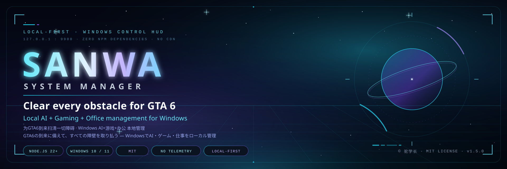

<div align="center">

[简体中文](README.md) · [English](README.en.md) · [日本語](README.ja.md)



# Sanwa System Manager

**Clear every obstacle for GTA 6 — Local AI + Gaming + Office management for Windows**

[](https://nodejs.org/)
[](#1-requirements)
[](LICENSE)
[](#-privacy--security)
[](docs/CONTRIBUTING.md)
[](docs/AI-INTEGRATION.md)

**One page to manage all your local AI tools, office apps and games on Windows.**
Pure Node.js local service · zero npm dependencies · no CDN · no telemetry · single-file sci-fi HUD · Chinese / English / Japanese

</div>

---

## 🎯 What is this?

Sanwa System Manager is a **local web console that runs on your own PC**. Open `http://127.0.0.1:9900` and you get a single HUD showing the status of every local AI / office / game tool, with one-click launch, one-click "make room", and one-click mode switching.

- **No cloud, no account, no telemetry** — your tools, paths, ID details and game library stay on your machine;
- **Does not modify your software** — it only runs whitelisted launcher scripts you configure; it never injects into games or edits game files;
- **Built for "gaming + AI + office" coexistence** — when GTA 6 lands, hit **Extreme Game Mode** and every AI/office app steps aside, leaving RAM and VRAM to the game.

> Tech stack: Node.js standard library + native Windows EXEs/COM + plain HTML/CSS/JS. No `node_modules`, no UI framework, no CDN.

---

## ✨ Features

| Capability | What it does |
|---|---|
| **41 tool cards** | AI / office / gaming / dev / knowledge tools across 10 categories; Chinese + English names with built-in `en` / `ja` descriptions; one-click and on-demand launch; port health checks |
| **Five modes** | Normal / AI / Office / Game / Extreme Game; fully configurable start/stop lists; protects DeepSeek Harness, the console itself, Steam, the accelerator and system processes |
| **On-demand AI launch** | Nothing AI starts at boot; click a card to launch exactly that tool; AI mode supports multi-select, remembers your last selection, and has a "Stop all" button |
| **Automatic game library scan** | Steam (`libraryfolders.vdf` + `appmanifest_*.acf`), WeGame, standalone/cracked folders, Epic detection, registry fallback; **31 games detected in our real-world test with scan roots configured** (the default config only auto-detects the standard Steam install); classified by platform / region / online-single-cracked |
| **Game launch orchestration** | Domestic games launch directly; overseas online games auto-start the accelerator; single-player/cracked games close Steam first with an optional admin firewall helper; every step is reported truthfully |
| **7-day weather + trend** | Current + 3-day + 7-day forecast with warming/cooling/rain/snow trend summaries; multi-source fallback and caching |
| **Almanac / divination / Bazi / name analysis** | Lunar calendar, auspicious/inauspicious activities, 64-hexagram coin toss, four pillars, five-grid name analysis — **computed locally, for entertainment only** |
| **Birthday gate & fireworks** | Optional name + ID entry (local only, masked); birthday countdown; full-screen fireworks on your birthday |
| **Resource HUD** | GPU (VRAM / utilization / temp / power / fan / processes), CPU (24-core mini-bars), RAM, network up/down, disks — 6 gauges, 2-second polling |
| **3 themes · 3 languages · custom background** | Dark / light / aurora; 简体中文 / English / 日本語; upload image or URL plus mask strength |
| **"Name a star after you"** | Star-naming animation, galaxy badge, star ID and constellation; respects `prefers-reduced-motion` |
| **Startup-item audit** | Lists autostart entries and their status; one-click toggle for the console's own logon autostart (service only, never your AI tools) |
| **Local-first · no telemetry** | Binds to `127.0.0.1` only; the only outbound request is weather; no analytics, no uploads, no accounts |

---

## 🖼 Preview

> For privacy reasons this repository **contains no real UI screenshots** (screenshots easily leak paths, accounts and game libraries). The visual below is a hand-drawn SVG banner plus an ASCII layout sketch; run it yourself and take your own sanitized screenshots if you want to show it off.


```text
┌──────────────────────────────────────────────────────────────────────────────┐
│  Sanwa System Manager              HUD  Modes  Settings  Language  Theme      │
├──────────────┬────────────────────────────────────────────┬─────────────────┤
│ Fortune /    │  Resource HUD (GPU / CPU / RAM / Net / Disk) │ Mode & services  │
│ Weather      │  ┌──────┐┌──────┐┌──────┐┌──────┐            │ · current mode   │
│ · 7-day      │  │ GPU  ││ VRAM ││ CPU  ││ MEM  │            │ · running tools  │
│ · Almanac    │  └──────┘└──────┘└──────┘└──────┘            │ · startup audit  │
│ · Divination │  [ Normal ][ AI ][ Office ][ Game ][ Extreme ] │ · recent activity│
│ · Bazi/Name  │  ┌────────┐┌────────┐┌────────┐              │                  │
│ · Birthday   │  │  Card  ││  Card  ││  Card  │ … 41 cards    │                  │
├──────────────┴────────────────────────────────────────────┴─────────────────┤
│ Game library (Steam / WeGame / standalone) · launch orchestration            │
└──────────────────────────────────────────────────────────────────────────────┘
```

---

## 🧩 The problems it solves

1. **Too many AI tools — you forget what is running and how much VRAM it eats** → one HUD, on-demand launch, stop-all.
2. **Closing a bunch of AI/office apps before gaming is tedious** → five modes make room in one click while protecting critical processes.
3. **Steam / WeGame / standalone games are scattered across drives** → automatic scan + classification + launch orchestration (accelerator, Steam offline).
4. **You keep installing apps just to check weather, almanac or Bazi** → one local page for all of it; everything except weather works offline.
5. **You don't want your data in any cloud** → local-only, no account, no telemetry; ID details are stored masked on your PC.
6. **You want an AI to help you customize the tool, but the project looks complex** → the repo is intentionally simple and well documented; **DeepSeek, Qwen, Doubao, Codex, Claude, Hermes and Hermes One can all understand it and help you deploy or modify it**.

---

## 🚀 Quick start

> Full guide: [docs/QUICKSTART.md](docs/QUICKSTART.md). (The guide is bilingual; this section is the English summary.)

### 1. Requirements

- **Windows 10 / 11 (x64)**
- **Node.js 22+** ([nodejs.org](https://nodejs.org/), LTS, keep *Add to PATH* checked)
- No `npm install`, no Python, no database

### 2. Get the code

```powershell
git clone <REPO_URL> "$env:USERPROFILE\sanwa-system-manager"
cd "$env:USERPROFILE\sanwa-system-manager"
```

Or download the GitHub ZIP and extract it so that `server.js`, `install.ps1` and `start-sanwa.cmd` are directly in the folder root.

### 3. Run the installer

```powershell
powershell -NoProfile -ExecutionPolicy Bypass -File .\install.ps1
```

It checks Node ≥ 22, creates `data\` / `logs\`, generates `data\tools.json` from `data\tools.example.json`, and copies the UI to your Desktop. Optional flags: `-Autostart` (logon autostart), `-Force` (overwrite existing config), `-Port <n>`.

### 4. Edit `data/tools.json`

Replace placeholder paths with the real locations on your machine (`%USERPROFILE%`, `%PROGRAMFILES%`, `%SANWA_AI_ROOT%`, etc. are expanded at install time; app-specific paths still need your input). See [docs/QUICKSTART.md](docs/QUICKSTART.md).

### 5. Start

Double-click **`start-sanwa.cmd`**, or run:

```powershell
node .\server.js
```

Then open **<http://127.0.0.1:9900>**.

### 6. First-run birthday gate

On first open you can enter your name + 18-digit ID (used for birthday countdown / fireworks / star naming). **The ID is validated and masked in the browser only**; the server stores masked fields, never the full ID, and never uploads it. You can skip it. See [docs/PRIVACY.md](docs/PRIVACY.md).

> Change the port with the `SANWA_PORT` environment variable (e.g. `setx SANWA_PORT 9901`). Autostart: `install.ps1 -Autostart` or the in-page toggle.

---

## 🎛 Five modes

| Mode | Purpose | Starts | Stops | Keeps |
|---|---|---|---|---|
| **Normal** | Manual; touches nothing | — | — | everything |
| **AI** | Local AI ready (multi-select) | Ollama / LM Studio / Open WebUI / ComfyUI… | office + entertainment apps | DSH, system processes |
| **Office** | Daytime work | WPS / LibreOffice / WeChat / DingTalk / Baidu Netdisk | image gen + entertainment | DSH, system processes |
| **Game** | Give RAM/VRAM to the game | — | all AI tools | DSH, Steam, accelerator, system processes |
| **Extreme Game** | Games and system only | — | all AI + office / social / entertainment / cloud sync | games, DSH, system processes |

Mode definitions live in `data/tools.json → modes` and are fully editable; protected processes are never closed. See [docs/MODES.md](docs/MODES.md).

---

## 🤖 Hand it to an AI: deploy / customize / troubleshoot

This project is **intentionally designed to be understood and extended by any mainstream AI — DeepSeek, Qwen, Doubao, Codex, Claude, Hermes, Hermes One and others**.

Open **[docs/AI-INTEGRATION.md](docs/AI-INTEGRATION.md)** for:

- 7 ready-to-copy prompts (DeepSeek / Qwen / Doubao / Codex / Claude / Hermes / Hermes One) covering deployment, generating `data/tools.json`, adding tool cards / modes / themes / languages, Steam/WeGame integration, troubleshooting and safety boundaries;
- a vendor-neutral deployment prompt;
- "audit and improve the project" and "generate a config for my machine" templates;
- Chinese / Japanese guides.

Replace `{REPO_URL}`, `{SANWA_HOME}` and `{WINDOWS_USER}` with your own values and paste the prompt into your AI.

---

## 🔒 Privacy & security

- **Sanitized repository**: no personal data, usernames, real paths, cities, ID numbers, screenshots or game inventory. Example configs use placeholders only. A `check-privacy.ps1` scan runs before every release.
- **Runtime data stays local**: `data/` and `logs/` are git-ignored; ID details are stored masked; the full ID is never written to disk or logs.
- **No telemetry, no account, no CDN, no npm dependencies**; the only outbound request is weather (wttr.in / Open-Meteo / weather.com.cn fallback).
- **Binds to `127.0.0.1` only**, launches only whitelisted scripts, stops only processes it started, and never silently elevates privileges (admin helpers must be run by you).
- ⚠️ Never change the bind address to `0.0.0.0` or expose it to the internet — there is no authentication layer.

Full details (including how to delete personal data and security recommendations): [docs/PRIVACY.md](docs/PRIVACY.md).

---

## 🤝 Fork / remix / contribute

- Star ⭐ if it helps; forks, themes, new tool cards and better versions are welcome;
- AI-generated code is welcome — verify it and mention it in the PR;
- Read [docs/CONTRIBUTING.md](docs/CONTRIBUTING.md) and [docs/PRIVACY.md](docs/PRIVACY.md) before opening an Issue/PR;
- **Keep the MIT copyright notice and attribution** (© 驼学长 / Tuoxuezhang); mention this project in your fork.

```powershell
# Before publishing (maintainers/contributors)
npm run check:privacy
# PASS - 0 hits. Safe to publish.
```

---

## 📁 Repository layout

```text
sanwa-system-manager/
├── server.js                    # Local HTTP API (Node stdlib, 127.0.0.1:9900)
├── install.ps1 / uninstall.ps1  # install / uninstall
├── start-sanwa.cmd              # one-click start + open browser
├── install-autostart.ps1        # logon autostart shortcut
├── package.json                 # metadata and scripts (no dependencies)
├── check-privacy.ps1            # pre-release sanitization scan
├── lib/
│   ├── modes.js                 # five-mode engine (pure Node)
│   ├── games/index.js           # game scanning + launch orchestration
│   └── fortune/                 # weather / almanac / divination / Bazi / name
├── scripts/                     # tool launchers, UI build, autostart VBS
├── web/
│   ├── ui.template.html         # UI source template
│   └── index.html               # built single-file UI
├── data/                        # example configs (runtime files are git-ignored)
├── tools/                       # Steam network-block helpers (admin)
├── docs/                        # documentation
└── .github/                     # Issue / PR templates
```

---

## ⚠️ Limitations & FAQ summary

- **Windows 10/11 + Node.js 22+ only** — no macOS / Linux / mobile support;
- Some features rely on native Windows programs and PowerShell; security software (Huorong / Defender) may block scripts — add `scripts\` to the trust list;
- Game classification is heuristic and can be overridden; accelerator paths, platform protocols and admin firewall helpers may fail on different machines (failures are reported truthfully, never faked);
- Almanac / Bazi / name analysis / divination are **for entertainment only**; weather data comes from third parties and may be inaccurate;
- This project does not include or provide game cracks, cheats, anti-cheat bypasses or copyrighted content.

More: [docs/FAQ.md](docs/FAQ.md) · Changes: [CHANGELOG.md](CHANGELOG.md) · Plans: [ROADMAP.md](ROADMAP.md).

---

## 📜 License & copyright

MIT License · **© 驼学长（Tuoxuezhang）**

Forks, remixes and commercial use are welcome — keep the copyright notice. Bundled third-party libraries (lunar-javascript / cnchar, etc.) retain their own MIT licenses; see `THIRD_PARTY_NOTICES.md`.

<div align="center">

**If this project saves you time, consider a ⭐ Star — or hand it to your AI assistant and make it better.**

[Quickstart](docs/QUICKSTART.md) · [AI prompts](docs/AI-INTEGRATION.md) · [Architecture](docs/ARCHITECTURE.md) · [API](docs/API.md) · [Privacy](docs/PRIVACY.md) · [Contributing](docs/CONTRIBUTING.md)

</div>
