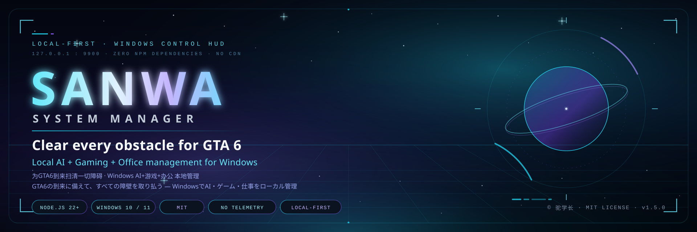

<div align="center">

[简体中文](README.md) · [English](README.en.md) · [日本語](README.ja.md)



# Sanwa システムマネージャー（Sanwa System Manager）

**GTA6の到来に備えて、すべての障壁を取り払う — WindowsでAI・ゲーム・仕事をローカル管理**

[](https://nodejs.org/)
[](#1-動作環境)
[](LICENSE)
[](#-プライバシーとセキュリティ)
[](docs/CONTRIBUTING.md)
[](docs/AI-INTEGRATION.md)

**1つの画面で、Windows 上の AI ツール・オフィスソフト・ゲームをまとめて管理。**
純粋な Node.js ローカルサービス · npm 依存なし · CDN なし · テレメトリーなし · 単一ファイルの SF HUD · 中/英/日対応

</div>

---

## 🎯 これは何？

Sanwa システムマネージャー（Sanwa System Manager）は、**自分の PC 上で動くローカル Web コンソール**です。`http://127.0.0.1:9900` を開くと、ローカルの AI / オフィス / ゲームツールの状態が 1 つの HUD に表示され、ワンクリックで起動・「道を空ける」・モード切替ができます。

- **クラウドなし・アカウントなし・テレメトリーなし** — ツール、パス、ID、ゲームライブラリはすべてあなたの PC の中だけに;
- **既存ソフトを改変しない** — あなたが設定したホワイトリスト方式の起動スクリプトを実行するだけで、ゲームへの注入やファイル改変は行いません;
- **「ゲーム + AI + 仕事」の共存のために設計** — GTA6 が来たら「極限ゲームモード」を押すだけで、AI とオフィスアプリが退き、メモリと VRAM をゲームに譲ります。

> 技術構成：Node.js 標準ライブラリ + Windows ネイティブ EXE/COM + 素の HTML/CSS/JS。`node_modules` も UI フレームワークも CDN もありません。

---

## ✨ 機能

| 機能 | 内容 |
|---|---|
| **41 枚のツールカード** | AI / オフィス / ゲーム / 開発 / ナレッジなど 10 カテゴリ。中国語名 + 英語名、`en` / `ja` の説明付き。ワンクリック起動・オンデマンド起動・ポートヘルスチェック |
| **5 つのモード** | 通常 / AI / オフィス / ゲーム / 極限ゲーム。起動・停止リストは自由に設定可能。DeepSeek Harness、コンソール本体、Steam、加速器、システムプロセスを保護 |
| **AI のオンデマンド起動** | 起動時に AI ツールを自動では起動しません。カードを押したものだけを起動。AI モードは複数選択・前回選択の記憶・一括停止に対応 |
| **ゲームライブラリ自動スキャン** | Steam（`libraryfolders.vdf` + `appmanifest_*.acf`）、WeGame、独立/非公式フォルダ、Epic 検出、レジストリのフォールバック。**スキャン範囲を設定した開発機で 31 本を検出**（既定設定では標準 Steam インストールのみ自動検出）。プラットフォーム / 国内・海外 / オンライン・シングル・非公式で分類 |
| **ゲーム起動オーケストレーション** | 国内ゲームは直接起動。海外オンラインは加速器（雷神）を自動起動。シングル/非公式は Steam を先に終了し、任意で管理者用ファイアウォール補助を実行。すべての結果を正直に返します |
| **7 日間天気 + トレンド** | 現在 + 3 日 + 7 日予報。気温上昇/下降、連続晴れ/雨/雪のサマリー。複数データソースとキャッシュのフォールバック |
| **暦 / おみくじ / 八字 / 姓名分析** | 旧暦、干支、宜忌、冲煞、64 卦の三枚硬貨占い、四柱推命、五格三才。**すべてローカル計算・娯楽目的** |
| **誕生日ゲート & 花火** | 初回に名前 + ID を任意入力（ローカルのみ・マスク保存）。誕生日カウントダウン、当日は全画面花火 |
| **リソース HUD** | GPU（VRAM / 使用率 / 温度 / 消費電力 / ファン / プロセス）、CPU（24 コア mini-bars）、メモリ、ネットワーク上下、ディスク。6 ゲージ・2 秒ポーリング |
| **3 テーマ・3 言語・カスタム背景** | ダーク / ライト / オーロラ。簡体字中国語 / English / 日本語。画像アップロードまたは URL + マスク濃度 |
| **「あなたの名前の星」** | 星空命名アニメーション、銀河バッジ、星 ID と星座。`prefers-reduced-motion` に対応 |
| **スタートアップ項目の監査** | 自動起動項目と状態を表示。コンソール自身のログオン自動起動はワンクリックで切替（軽量サービスのみ、AI ツールは起動しない） |
| **ローカル優先・テレメトリーなし** | `127.0.0.1` のみにバインド。外部通信は天気のみ。分析・アップロード・アカウントなし |

---

## 🖼 プレビュー

> プライバシー保護のため、本リポジトリには**実際の UI スクリーンショットを一切含めていません**（スクリーンショットはパス・アカウント・ゲームライブラリを漏らしやすいため）。以下のビジュアルは手描き SVG バナーと ASCII レイアウト図です。実際に動かして、個人情報を消した上でご自身で撮影してください。


```text
┌──────────────────────────────────────────────────────────────────────────────┐
│  Sanwa システムマネージャー        HUD  モード  設定  言語  テーマ            │
├──────────────┬────────────────────────────────────────────┬─────────────────┤
│ 占い / 天気   │  リソース HUD（GPU / CPU / RAM / Net / Disk）  │ モードとサービス  │
│ · 7 日天気    │  ┌──────┐┌──────┐┌──────┐┌──────┐            │ · 現在のモード    │
│ · 暦          │  │ GPU  ││ VRAM ││ CPU  ││ MEM  │            │ · 実行中ツール    │
│ · おみくじ    │  └──────┘└──────┘└──────┘└──────┘            │ · 起動項目監査    │
│ · 八字/姓名   │  [ 通常 ][ AI ][ オフィス ][ ゲーム ][ 極限 ]  │ · 最近の操作      │
│ · 誕生日      │  ┌────────┐┌────────┐┌────────┐              │                  │
│              │  │ カード  ││ カード  ││ カード  │ … 41 枚       │                  │
├──────────────┴────────────────────────────────────────────┴─────────────────┤
│ ゲームライブラリ（Steam / WeGame / 独立）· 起動オーケストレーション           │
└──────────────────────────────────────────────────────────────────────────────┘
```

---

## 🧩 何を解決するか

1. **AI ツールが増えすぎて、何が動いているか・VRAM をどれだけ使うか分からない** → HUD で一覧、オンデマンド起動、一括停止。
2. **ゲーム前に AI やオフィスソフトを手動で大量に終了するのが面倒** → 5 モードでワンクリックに道を空け、重要プロセスは保護。
3. **Steam / WeGame / 独立ゲームが複数ドライブに散らばっている** → 自動スキャン + 分類 + 起動オーケストレーション（加速器、Steam オフライン）。
4. **天気・暦・八字を見るためだけにアプリを入れたくない** → ローカル 1 ページに全部。天気以外はオフラインで動作。
5. **データをクラウドに渡したくない** → ローカルのみ、アカウントなし、テレメトリーなし。ID は PC 上でマスク保存。
6. **AI にカスタマイズを手伝ってほしいが、プロジェクトが複雑そうに見える** → 構造はシンプルでドキュメントも充実。**DeepSeek / Qwen / Doubao / Codex / Claude / Hermes / Hermes One など任意の AI が理解し、導入や改造を手伝えます**。

---

## 🚀 クイックスタート

> 詳細（中英バイリンガル）は [docs/QUICKSTART.md](docs/QUICKSTART.md) を参照。

### 1. 動作環境

- **Windows 10 / 11（x64）**
- **Node.js 22 以上**（[nodejs.org](https://nodejs.org/) の LTS、インストール時に *Add to PATH* をチェック）
- `npm install`・Python・データベースは不要

### 2. 取得

```powershell
git clone <REPO_URL> "$env:USERPROFILE\sanwa-system-manager"
cd "$env:USERPROFILE\sanwa-system-manager"
```

または GitHub の ZIP をダウンロードし、`server.js`・`install.ps1`・`start-sanwa.cmd` がフォルダ直下に来るように解凍します。

### 3. インストーラを実行

```powershell
powershell -NoProfile -ExecutionPolicy Bypass -File .\install.ps1
```

Node 22 以上の確認 → `data\` / `logs\` 作成 → `data\tools.example.json` から `data\tools.json` 生成 → UI をデスクトップにコピー、を行います。オプション：`-Autostart`（ログオン自動起動）、`-Force`（既存設定を上書き）、`-Port <n>`。

### 4. `data\tools.json` を編集

プレースホルダーを実際のパスに置き換えます（`%USERPROFILE%`・`%PROGRAMFILES%`・`%SANWA_AI_ROOT%` などはインストール時に展開されます）。詳細は [docs/QUICKSTART.md](docs/QUICKSTART.md)。

### 5. 起動

**`start-sanwa.cmd`** をダブルクリック、または：

```powershell
node .\server.js
```

ブラウザで **<http://127.0.0.1:9900>** を開きます。

### 6. 初回の誕生日ゲート

初回は名前 + 18 桁 ID の入力画面が出ます（誕生日カウントダウン / 花火 / 「あなたの名前の星」用）。**ID はブラウザ内だけで検証・マスクされ、サーバーはマスク済み項目のみ保存、完全な ID はディスクにもログにも残らず、アップロードされません**。スキップ可能。詳細は [docs/PRIVACY.md](docs/PRIVACY.md)。

> ポート変更は環境変数 `SANWA_PORT`（例：`setx SANWA_PORT 9901`）。自動起動は `install.ps1 -Autostart` または画面内のトグル。

---

## 🎛 5 つのモード

| モード | 用途 | 起動 | 停止 | 保持 |
|---|---|---|---|---|
| **通常** | 手動。何もしない | — | — | すべて |
| **AI** | ローカル AI を準備（複数選択可） | Ollama / LM Studio / Open WebUI / ComfyUI… | オフィス + 娯楽アプリ | DSH、システムプロセス |
| **オフィス** | 日中の仕事用 | WPS / LibreOffice / WeChat / DingTalk / Baidu Netdisk | 画像生成 + 娯楽 | DSH、システムプロセス |
| **ゲーム** | メモリ/VRAM をゲームに | — | すべての AI ツール | DSH、Steam、加速器、システムプロセス |
| **極限ゲーム** | ゲームとシステムのみ | — | すべての AI + オフィス / SNS / 娯楽 / クラウド同期 | ゲーム、DSH、システムプロセス |

モード定義は `data/tools.json → modes` にあり自由に編集可能。保護リスト内のプロセスは決して終了しません。詳細は [docs/MODES.md](docs/MODES.md)。

---

## 🤖 AI に任せる：導入 / 改造 / トラブルシューティング

本プロジェクトは **DeepSeek / Qwen / Doubao / Codex / Claude / Hermes / Hermes One など任意の主要 AI がスムーズに理解・連携できるように設計**されています。

[**docs/AI-INTEGRATION.md**](docs/AI-INTEGRATION.md) には：

- そのままコピーできる 7 つのプロンプト（DeepSeek / Qwen / Doubao / Codex / Claude / Hermes / Hermes One）。導入、`data/tools.json` の生成、ツールカード / モード / テーマ / 言語の追加、Steam / WeGame 連携、トラブルシューティング、安全境界をカバー；
- 汎用導入プロンプト、「AI にプロジェクトを監査・改善させる」「AI に自分の環境用の設定を生成させる」テンプレート；
- 中文 / English / 日本語ガイド。

`{REPO_URL}`・`{SANWA_HOME}`・`{WINDOWS_USER}` をご自身の値に置き換えて AI に貼り付けてください。

---

## 🔒 プライバシーとセキュリティ

- **リポジトリは脱敏済み**：個人データ、ユーザー名、実パス、都市、ID、スクリーンショット、ゲームライブラリを含みません。設定例はすべてプレースホルダー。リリース前に `check-privacy.ps1` を実行。
- **実行時データはローカルのみ**：`data/`・`logs/` は git-ignore 済み。ID はマスク保存、完全な ID はディスクにもログにも残しません。
- **テレメトリー・アカウント・CDN・npm 依存なし**。外部通信は天気のみ（wttr.in / Open-Meteo / weather.com.cn フォールバック）。
- **`127.0.0.1` のみにバインド**、ホワイトリストのスクリプトのみ実行、停止は本サービスが起動したプロセスのみ、管理者権限が必要な補助は手動実行（暗黙の昇格なし）。
- ⚠️ バインド先を `0.0.0.0` に変更したり、インターネットへ公開しないでください。認証レイヤーがありません。

詳細（個人データの削除方法・セキュリティ推奨事項）：[docs/PRIVACY.md](docs/PRIVACY.md)。

---

## 🤝 Fork / 二次創作 / コントリビュート

- 役に立ったら ⭐ Star を。Fork、テーマ作成、ツールカード追加、より良いバージョン作成を歓迎します;
- AI 生成コードも歓迎。ご自身で検証し、PR にその旨を記載してください;
- Issue / PR の前に [docs/CONTRIBUTING.md](docs/CONTRIBUTING.md) と [docs/PRIVACY.md](docs/PRIVACY.md) をお読みください;
- **MIT の著作権表示と出典を保持**してください（© 驼学长 / Tuoxuezhang）。二次創作では本プロジェクトを明記してください。

```powershell
# 公開前（メンテナ / コントリビュータ）
npm run check:privacy
# PASS - 0 hits. Safe to publish.
```

---

## 📁 ディレクトリ構成

```text
sanwa-system-manager/
├── server.js                    # ローカル HTTP API（Node 標準ライブラリ、127.0.0.1:9900）
├── install.ps1 / uninstall.ps1  # インストール / アンインストール
├── start-sanwa.cmd              # ワンクリック起動 + ブラウザ表示
├── install-autostart.ps1        # ログオン自動起動ショートカット
├── package.json                 # メタデータとスクリプト（依存なし）
├── check-privacy.ps1            # 公開前の脱敏スキャン
├── lib/
│   ├── modes.js                 # 5 モードエンジン（純 Node）
│   ├── games/index.js           # ゲームスキャン + 起動オーケストレーション
│   └── fortune/                 # 天気 / 暦 / おみくじ / 八字 / 姓名
├── scripts/                     # ツール起動スクリプト、UI ビルド、自動起動 VBS
├── web/
│   ├── ui.template.html         # UI ソーステンプレート
│   └── index.html               # ビルド済み単一ファイル UI
├── data/                        # 設定例（実行時ファイルは git-ignore）
├── tools/                       # Steam ネットワーク遮断補助（管理者用）
├── docs/                        # ドキュメント
└── .github/                     # Issue / PR テンプレート
```

---

## ⚠️ 制限と FAQ 要約

- **Windows 10/11 + Node.js 22 以上のみ**。macOS / Linux / モバイル非対応;
- 一部機能は Windows ネイティブプログラムと PowerShell に依存。セキュリティソフト（Huorong / Defender）がスクリプトをブロックする場合があるため、`scripts\` を信頼リストに追加してください;
- ゲーム分類はヒューリスティックで手動上書き可能。加速器パス、プラットフォームプロトコル、管理者用ファイアウォール補助は環境により失敗することがあります（失敗は正直に返し、成功を偽装しません）;
- 暦 / 八字 / 姓名分析 / おみくじは**娯楽目的のみ**。天気データは第三者提供のため誤差があります;
- 本プロジェクトはゲームのクラック、チート、アンチチート回避、著作権コンテンツを提供・同梱しません。

詳細：[docs/FAQ.md](docs/FAQ.md) · 変更履歴：[CHANGELOG.md](CHANGELOG.md) · 計画：[ROADMAP.md](ROADMAP.md)。

---

## 📜 ライセンスと著作権

MIT License · **© 驼学长（Tuoxuezhang）**

Fork、二次創作、商用利用を歓迎します（著作権表示を保持してください）。同梱のサードパーティライブラリ（lunar-javascript / cnchar など）はそれぞれの MIT ライセンスを保持します。詳細は `THIRD_PARTY_NOTICES.md`。

<div align="center">

**このプロジェクトが時間の節約になったら、⭐ Star をお願いします。AI アシスタントと一緒に改良するのも歓迎です。**

[クイックスタート](docs/QUICKSTART.md) · [AI プロンプト](docs/AI-INTEGRATION.md) · [アーキテクチャ](docs/ARCHITECTURE.md) · [API](docs/API.md) · [プライバシー](docs/PRIVACY.md) · [コントリビュート](docs/CONTRIBUTING.md)

</div>
