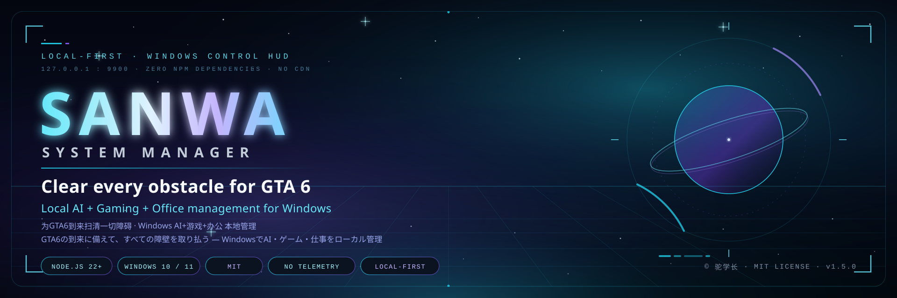

<div align="center">

[简体中文](README.md) · [English](README.en.md) · [日本語](README.ja.md)



# Sanwa 系统管理器 · Sanwa System Manager

**为GTA6到来扫清一切障碍 · Windows AI+游戏+办公 本地管理**

[](https://nodejs.org/)
[](#1-环境要求)
[](LICENSE)
[](#-隐私与安全)
[](docs/CONTRIBUTING.md)
[](docs/AI-INTEGRATION.md)

**一个页面，管好整台 Windows 上的 AI 工具、办公软件和游戏。**
纯 Node.js 本地服务 · 无 npm 依赖 · 无 CDN · 无遥测 · 单文件科幻 HUD 界面 · 中 / 英 / 日三语

</div>

---

## 🎯 这是什么

Sanwa 系统管理器（Sanwa System Manager）是一个 **运行在你自己电脑上的 Web 控制台**：打开 `http://127.0.0.1:9900`，就能看到本机所有 AI / 办公 / 游戏工具的运行状态，一键启动、一键让路、一键切换模式。

- **不做云、不做账号、不做遥测**：你的工具、路径、身份证、游戏库都只在本机；
- **不改变你的软件**：只按白名单调用你配置的启动脚本，不注入、不修改游戏文件；
- **专为「游戏 + AI + 办公」共存设计**：GTA6 来了，点一下「极端游戏模式」，AI 和办公应用全部让路，内存与显存留给游戏。

> 技术底色：Node.js 标准库 + Windows 原生 EXE/COM + 纯 HTML/CSS/JS。没有 `node_modules`，没有外部框架，没有 CDN。

---

## ✨ 功能特性

| 能力 | 说明 |
|---|---|
| **41 个工具卡片** | AI / 办公 / 游戏 / 开发 / 知识库等 10 类工具；中文名 + 英文名，内置 `en` / `ja` 简介；一键启动、按需启动、端口健康检查 |
| **五种模式** | 正常 / AI / 办公 / 游戏 / 极端游戏；关闭什么、保留什么全部可配置；保护 DeepSeek Harness、控制中心、Steam、雷神与系统进程 |
| **AI 按需启动** | 开机不自动拉起任何 AI 工具；点哪张卡片启动哪个；AI 模式支持多选启动、记忆上次选择、全部停止 |
| **游戏库自动扫描** | Steam（libraryfolders + appmanifest）、WeGame、独立/破解目录、Epic 识别、注册表兜底；配置好扫描范围后在开发机实测可识别 31 款（默认配置只自动探测标准 Steam 安装目录）；分类为平台 / 境内境外 / 单机联机 / 破解 |
| **游戏启动编排** | 境内直接启动；境外联机自动拉起雷神加速器；单机/破解先关 Steam，可选管理员防火墙断网辅助；全部动作如实返回结果 |
| **7 日天气 + 趋势** | 实时 + 3 日 + 7 日预报；升温 / 降温 / 连晴 / 连雨 / 降雪提醒；多数据源与缓存降级 |
| **黄历 / 抽签 / 八字 / 姓名** | 农历、干支、宜忌、冲煞、64 卦三枚铜钱摇卦、四柱五行、五格三才；**离线计算，仅供娱乐** |
| **生日门禁与礼花** | 首次录入姓名 + 身份证（仅本机、脱敏保存）；生日倒计时、生日当天全屏礼花 |
| **资源 HUD** | GPU（显存 / 利用率 / 温度 / 功耗 / 风扇 / 显存进程）、CPU（24 核 mini-bars）、内存、网络上下行、磁盘，6 仪表 2 秒轮询 |
| **三主题 · 三语言 · 自定义背景** | 深色 / 浅色 / 动态绚丽；简体中文 / English / 日本語；上传或 URL 背景 + 遮罩浓度 |
| **「以你命名一颗星」** | 星空命名动画、银河徽章、星名编号与星座；尊重 `prefers-reduced-motion` |
| **开机启动项审计** | 展示自启项与状态；控制中心自启可一键开关（只启动轻量服务，不启动 AI 工具） |
| **纯本机 · 无遥测** | 只监听 `127.0.0.1`；唯一外联是天气查询；无统计、无上传、无账号 |

---

## 🖼 界面预览

> 为保证隐私，本仓库**不包含任何真实界面截图**（截图容易泄露路径、账号、游戏库存）。下面的视觉素材是手绘 SVG 横幅与 ASCII 架构图；你可以在自己机器上运行后自行截图分享。


```text
┌──────────────────────────────────────────────────────────────────────────────┐
│  Sanwa 系统管理器                        HUD  模式  设置  语言  主题          │
├──────────────┬────────────────────────────────────────────┬─────────────────┤
│ 玄学 / 天气   │  系统资源 HUD（GPU / CPU / 内存 / 网络 / 磁盘）  │ 模式与服务状态    │
│ · 7 日天气    │  ┌──────┐┌──────┐┌──────┐┌──────┐          │ · 当前模式       │
│ · 黄历        │  │ GPU  ││ VRAM ││ CPU  ││ MEM  │          │ · 运行中的服务    │
│ · 抽签        │  └──────┘└──────┘└──────┘└──────┘          │ · 开机启动审计    │
│ · 八字/姓名   │  [ 正常 ][ AI ][ 办公 ][ 游戏 ][ 极端游戏 ]   │ · 最近操作日志    │
│ · 生日倒计时  │  ┌────────┐┌────────┐┌────────┐            │                 │
│              │  │ 工具卡片 ││ 工具卡片 ││ 工具卡片 │  …41 张    │                 │
│              │  └────────┘└────────┘└────────┘            │                 │
├──────────────┴────────────────────────────────────────────┴─────────────────┤
│ 游戏库（Steam / WeGame / 独立）· 启动编排 · 加速器 / Steam 离线                │
└──────────────────────────────────────────────────────────────────────────────┘
```

---

## 🧩 它解决什么问题

1. **AI 工具越装越多，记不住谁在跑、占多少显存** → HUD 一屏看全，按需启动，一键停止。
2. **打游戏前要手动关一堆 AI 和办公软件** → 五种模式一键让路，保护关键进程不被误杀。
3. **Steam / WeGame / 独立游戏分散在多个盘** → 自动扫描 + 分类 + 启动编排（加速器、Steam 离线）。
4. **为了看黄历/天气/八字装一堆 App** → 一个本地页面全都有，除天气外全部离线。
5. **不想把数据交给任何云服务** → 纯本机、无账号、无遥测；身份证只在本机脱敏保存。
6. **想让 AI 帮自己改工具，但项目太复杂** → 本项目结构清晰、文档齐全，**DeepSeek / 千问 / 豆包 / Codex / Claude / Hermes / Hermes One 等任意 AI 都能读懂并帮你部署改造**。

---

## 🚀 快速开始

> 完整步骤（含英文版）见 [docs/QUICKSTART.md](docs/QUICKSTART.md)。

### 1. 环境要求

- **Windows 10 / 11**（x64）
- **Node.js 22 或更高**（[nodejs.org](https://nodejs.org/) 下载 LTS，安装时勾选 Add to PATH）
- 无需 npm install、无需 Python、无需数据库

### 2. 下载并解压

```powershell
git clone <REPO_URL> "$env:USERPROFILE\sanwa-system-manager"
cd "$env:USERPROFILE\sanwa-system-manager"
```

或从 GitHub 下载 ZIP 解压（确保根目录直接能看到 `server.js`、`install.ps1`、`start-sanwa.cmd`）。

### 3. 运行安装脚本

```powershell
powershell -NoProfile -ExecutionPolicy Bypass -File .\install.ps1
```

它会：检查 Node ≥ 22 → 创建 `data\` / `logs\` → 从 `data\tools.example.json` 生成 `data\tools.json` → 把界面复制到桌面。可选参数：`-Autostart`（登录自启）、`-Force`（覆盖已有配置）、`-Port <n>`（端口）。

### 4. 编辑 `data/tools.json`

把示例里的占位符改成你本机的真实路径（`%USERPROFILE%`、`%PROGRAMFILES%`、`%SANWA_AI_ROOT%` 等安装时已展开；具体软件路径需要你按 [docs/QUICKSTART.md](docs/QUICKSTART.md) 填写）。

### 5. 启动

双击 **`start-sanwa.cmd`**，或运行：

```powershell
node .\server.js
```

浏览器打开 **<http://127.0.0.1:9900>**。

### 6. 首次身份门禁

首次打开会要求填写姓名 + 18 位身份证（用于生日倒计时 / 礼花 / 以你命名一颗星）。**身份证只在浏览器端校验并脱敏，服务端只保存脱敏字段，不落盘完整号码、不上传**；可跳过或稍后填写。详见 [docs/PRIVACY.md](docs/PRIVACY.md)。

> 想换端口？设置环境变量 `SANWA_PORT`（如 `setx SANWA_PORT 9901`）。想开机自启？`install.ps1 -Autostart` 或页面里一键开关。

---

## 🎛 五种模式

| 模式 | 用途 | 启动 | 关闭 | 保留 |
|---|---|---|---|---|
| **正常模式** | 手动模式，什么都不动 | — | — | 全部 |
| **AI 模式** | 本地 AI 就绪（可多选） | Ollama / LM Studio / Open WebUI / ComfyUI… | 办公 + 娱乐应用 | DSH、系统进程 |
| **办公模式** | 白天工作 | WPS / LibreOffice / 微信 / 钉钉 / 百度网盘 | 生图 + 娱乐应用 | DSH、系统进程 |
| **游戏模式** | 把内存/显存让给游戏 | — | 全部 AI 工具 | DSH、Steam、雷神、系统进程 |
| **极端游戏模式** | 只留游戏与系统 | — | 全部 AI + 办公/社交/娱乐/云同步 | 游戏、DSH、系统进程 |

模式定义在 `data/tools.json → modes`，可自由增删改；受保护名单内进程永不关闭。详见 [docs/MODES.md](docs/MODES.md)。

---

## 🤖 交给 AI：部署 / 改造 / 排错

本项目**精心设计为可被 DeepSeek / 通义千问 / 豆包 / Codex / Claude / Hermes / Hermes One 等任意 AI 丝滑理解与对接**。

打开 [**docs/AI-INTEGRATION.md**](docs/AI-INTEGRATION.md)，里面有：

- 7 段**可直接复制**的 AI 提示词（DeepSeek / 千问 / 豆包 / Codex / Claude / Hermes / Hermes One），覆盖部署、生成 `data/tools.json`、新增工具卡片 / 模式 / 主题 / 语言、接入 Steam / WeGame、排错、安全边界；
- 通用部署提示词、让 AI 审计并改进项目、让 AI 为你的设备生成配置；
- English / 日本語 guide。

把 `{REPO_URL}`、`{SANWA_HOME}`、`{WINDOWS_USER}` 换成你自己的信息，粘给 AI 即可。

---

## 🔒 隐私与安全

- **仓库已脱敏**：无个人数据、无真实用户名/路径/城市/身份证、无真实截图、无本机游戏库存；示例配置全部使用占位符；发布前会运行 `check-privacy.ps1`。
- **运行时数据只在本机**：`data/`、`logs/` 由 `.gitignore` 排除；身份证只存脱敏字段；完整号码不落盘、不写日志。
- **无遥测、无账号、无 CDN、无 npm 依赖**；唯一外联是天气（wttr.in / Open-Meteo / 中国天气网兜底）。
- **只监听 `127.0.0.1`**、启动只执行白名单脚本、停止只针对本服务拉起的进程、需要管理员权限的辅助脚本由你手动运行。
- ⚠️ 请勿把服务改成 `0.0.0.0` 或做公网端口映射——本项目没有登录鉴权。

完整说明（含删除个人数据方法、安全建议）见 [docs/PRIVACY.md](docs/PRIVACY.md)。

---

## 🤝 欢迎 Fork / 二创 / 贡献

- 喜欢就 Star ⭐，欢迎 Fork、改主题、加工具、做更好的版本；
- 用 AI 写的代码也欢迎，请自行验证并在 PR 中注明；
- 提 Issue / PR 前请读 [docs/CONTRIBUTING.md](docs/CONTRIBUTING.md) 与 [docs/PRIVACY.md](docs/PRIVACY.md)；
- **保留 MIT 版权声明与来源**（© 驼学长），二创请注明基于本项目。

```powershell
# 发布前（维护者/贡献者）隐私扫描
npm run check:privacy
# PASS - 0 hits. Safe to publish.
```

---

## 📁 目录结构

```text
sanwa-system-manager/
├── server.js                    # 本地 HTTP API 服务（Node 标准库，127.0.0.1:9900）
├── install.ps1 / uninstall.ps1  # 安装 / 卸载
├── start-sanwa.cmd              # 一键启动并打开浏览器
├── install-autostart.ps1        # 登录自启快捷方式
├── package.json                 # 元数据与脚本（无 dependencies）
├── check-privacy.ps1            # 发布前脱敏扫描
├── lib/
│   ├── modes.js                 # 五模式引擎（纯 Node）
│   ├── games/index.js           # 游戏库扫描 + 启动编排
│   └── fortune/                 # 天气 / 黄历 / 抽签 / 八字 / 姓名
├── scripts/                     # 工具启动/停止脚本、构建 UI、自启 VBS
├── web/
│   ├── ui.template.html         # 界面源模板
│   └── index.html               # 构建产物（单文件）
├── data/                        # 示例配置（运行时生成 tools.json 等，已被 gitignore）
├── tools/                       # Steam 断网辅助脚本（管理员用）
├── docs/                        # 文档（本目录）
└── .github/                     # Issue / PR 模板
```

---

## ⚠️ 限制与 FAQ 摘要

- **仅支持 Windows 10/11 + Node.js 22+**，不支持 macOS / Linux / 手机；
- 部分功能依赖 Windows 原生程序与 PowerShell，安全软件（火绒 / Defender）可能拦截脚本，请将 `scripts\` 加入信任区；
- 游戏分类是启发式识别，可手动覆盖；加速器路径、平台协议、管理员断网在不同机器上可能失效（会如实报错，不伪造成功）；
- 黄历 / 八字 / 姓名 / 抽签**仅供娱乐**；天气数据来自第三方，可能有误差；
- 本项目不提供、不包含任何游戏破解、外挂、反作弊绕过或版权内容。

更多问题见 [docs/FAQ.md](docs/FAQ.md) · 版本变更见 [CHANGELOG.md](CHANGELOG.md) · 规划见 [ROADMAP.md](ROADMAP.md)。

---

## 📜 版权与许可

MIT License · **© 驼学长（Tuoxuezhang）**

欢迎 Fork、二创与商用（保留版权声明）。内置第三方库（lunar-javascript / cnchar 等）保留各自 MIT 许可，详见 `THIRD_PARTY_NOTICES.md`。

<div align="center">

**如果这个项目帮你省下了时间，欢迎点一个 ⭐ Star，或把它交给你的 AI 助手一起改造。**

[快速开始](docs/QUICKSTART.md) · [AI 提示词](docs/AI-INTEGRATION.md) · [架构说明](docs/ARCHITECTURE.md) · [API](docs/API.md) · [隐私](docs/PRIVACY.md) · [贡献](docs/CONTRIBUTING.md)

</div>
